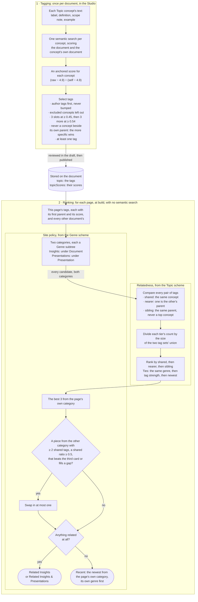

> **Archived copy.** From `andybywire/andyfitzgeraldconsulting`,
> `docs/recommendations-research/related-algorithm.md`, at commit `ae73f98` (2026-11-24). Paths and links in it refer to
> that repository, where the whole research folder stays in git history at that commit.

# Related resources: where the algorithm landed

*2026-11-12. The configuration the research settled on: v5's tags under v4's ranking rule.
Stream 2 wired the site to it on branch `related-ranker` (2026-11-23), without tag scores until
stream 3; until that branch merges, the live site runs the older branch rule.*

It runs in two stages. **Tagging** happens once per document, and it is the only place a
semantic search runs. **Ranking** happens for every page at build, from the stored tags alone.
Inside ranking, relatedness comes from the Topic scheme, and the rest is site policy built on
the Genre scheme.

## Reading it

- **Tag strength** is, for each concept two documents share, the weaker of their two scores,
  summed. Two pieces strongly about what they share outrank two that only brush it.
- **"First parent"** is `broader[0]`. SKOS leaves `skos:broader` unordered, so a concept with
  two parents is related through the first one only. That's a Sanity habit, not a SKOS rule.
- **Nearer and sibling never cross categories.** Crossing is for pieces about the same thing, so
  only shared tags count toward it.
- **A tie on every tier** keeps the pool's order, which is newest first.

| Part | Where it lives |
|---|---|
| Tagging | `studio/tagger/`: `score.ts` (queries), `tagger.ts` (selection), `propose.ts` (author tags and exclusions) |
| Stored tags | `topic` and `topicScores` on articles, case studies, notes and presentations |
| Relatedness and policy | `web/src/lib/related.ts` → `rankAcross`, under `RANK_RULE`: `CROSS_RULE` and `tieBreak: 'genre-strength'` |
| Categories | `web/src/lib/genres.ts` → `subtree`, from the Genre scheme's two top concepts |
